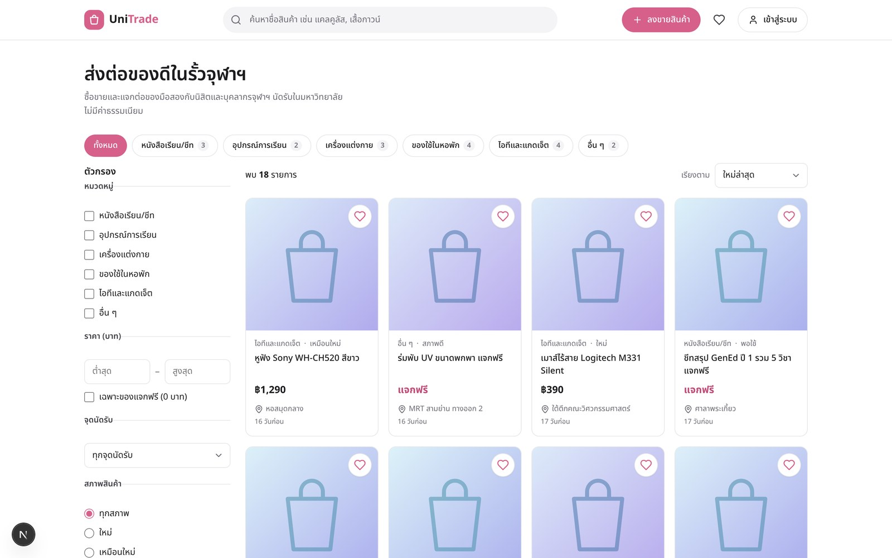
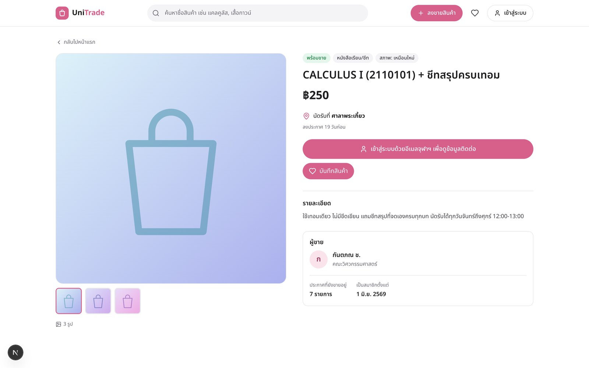

# 🛍️ UniTrade

**A second-hand marketplace for Chulalongkorn University students and staff: sign up with a Chula email, post items you no longer need, and meet on campus to hand them over.**


**Software Engineering course project** · team "VISIT CMU" · 2026

**My role: Frontend Lead** ([Hidayat Buha](https://github.com/Balakkak))

> This is my fork of the team repository: [maneekongritphichayaporn-creator/UniTrade](https://github.com/maneekongritphichayaporn-creator/UniTrade).
> The team's original README (in Thai, with the task status of every member) is kept in [README.th.md](README.th.md).

<p>
  
  
</p>

*Home page and product detail page, both built by me. Screenshots are from the app's mock-data mode, so the product photos are placeholders.*

---

## Contents

1. [About the project](#1-about-the-project)
2. [My contributions](#2-my-contributions)
3. [Pages I built](#3-pages-i-built)
4. [How the frontend is built](#4-how-the-frontend-is-built)
5. [Testing and checks](#5-testing-and-checks)
6. [Run it locally](#6-run-it-locally)
7. [What I learned](#7-what-i-learned)

---

## 1. About the project

Students and staff at Chulalongkorn University have textbooks, study notes and dorm items they no longer need. UniTrade is a campus marketplace for them.

- Sign up with a **Chula email**.
- Post second-hand items with photos, price (or free), condition and a campus pickup point.
- Search and filter, save items to a wishlist, and contact the seller.
- **No payment, no shipping and no in-app chat**: buyer and seller meet on campus.

| Part | Choice |
|---|---|
| Web app and API | Next.js 15 App Router (JavaScript), API under `/api/v1` |
| Database and images | Supabase (Postgres + Storage) |
| Login | The team's own JWT (24 hours) |
| Hosting | Vercel |

The team worked from an SRS, a UI design in Figma, ER and sequence diagrams and an API specification (v2.2). Each task had its own branch and pull request, reviewed by the Backend Lead.

## 2. My contributions

I led the frontend. Before my work, the repository had only the backend: the home page was a placeholder that said "UniTrade API".

| Pull request | What it added | Size |
|---|---|---|
| [#3 TASK-07: Layout, Navbar, Routing, Theme](https://github.com/maneekongritphichayaporn-creator/UniTrade/pull/3) | The base that every other page uses | +2,673 / −3 |
| [#4 TASK-10 + TASK-16: Home page, product grid, search and filters](https://github.com/maneekongritphichayaporn-creator/UniTrade/pull/4) | The home page, connected to the products, categories and pickup-points APIs | +2,648 / −9 |
| [#5 TASK-18: Product detail page and seller contact](https://github.com/maneekongritphichayaporn-creator/UniTrade/pull/5) | The product page and the "contact seller" flow | +1,352 / −6 |
| [#6 TASK-23: Vercel deploy guide](https://github.com/maneekongritphichayaporn-creator/UniTrade/pull/6) | How to deploy, and what to check after deploying | +154 |

All four were reviewed and merged. The first three were stacked (each built on the one before) so they could be reviewed in order. I also wrote the frontend changelog ([docs/TASK-07-10-16-18-CHANGELOG.md](docs/TASK-07-10-16-18-CHANGELOG.md)) and the UI design section of the course report ([docs/REPORT-FRONTEND.md](docs/REPORT-FRONTEND.md)).

**I did not touch any backend file**, and I added no new libraries.

## 3. Pages I built

### Layout and theme (TASK-07)
- **One theme file:** all colors, sizes and shadows are variables in one place, with shared classes for buttons, badges, inputs, cards and loading skeletons.
- **Layout:** Thai font (Noto Sans Thai), a skip link for keyboard users, navbar, main area and footer.
- **Navbar:** logo, search box, "sell an item" button, wishlist, and a right side that changes when you log in.
- **404 page:** paths that teammates had not built yet land on a friendly page instead of breaking.

### Home page, search and filters (TASK-10 + TASK-16)
- **Product cards:** photo (lazy-loaded), title cut to 2 lines, price, status badge, pickup point and "posted 3 days ago".
- **Responsive grid:** 2 columns on phones, 3 on tablets, 4 on desktops, 12 items per page.
- **Status badges:** green for available, orange for reserved, grey for sold.
- **Price 0 shows "Free"** (แจกฟรี) instead of "0 baht".
- **Category bar** with item counts, and you can pick more than one category.
- **Every filter the API supports:** keyword, category, price range, free only, status, pickup point, condition and sort.
- **The URL holds all the filters.** The back button, refresh and shared links all keep the same filters. Default values are left out, so shared links stay short, and changing a filter goes back to page 1.
- Search waits 400 ms after typing before it calls the API.
- **Desktop:** a sticky filter sidebar. **Phone:** a "Filters" button that shows how many filters are on.
- **Loading:** skeleton cards keep the page height steady. **Errors:** a clear message with a "try again" button.

### Product detail and seller contact (TASK-18)
- **Photo gallery** with thumbnails, the main photo first.
- A note above the button when an item is reserved or sold.
- **Contact the seller:**
  - Not logged in → go to the login page and come back to the same product afterwards.
  - Logged in → the contact details are loaded **only when you press the button**, then shown in a pop-up with LINE and phone links and a safety reminder to meet on campus.
  - So the seller's contact details are never in the page data that every visitor downloads.

## 4. How the frontend is built

- **One API client** (`lib/client/api.js`): attaches the login token, and turns API errors into one error type with a code, a Thai message and the field that failed.
- **One login state** (`useAuth()`): every component sees the same login status.
- **All routes in one file** (`lib/client/routes.js`), plus `safeNextPath()`, which only allows safe in-site paths after login, to block open-redirect attacks.
- **Mock-data mode:** with `NEXT_PUBLIC_USE_MOCK_API=true`, the frontend runs without the backend. Teammates could build and demo pages before the APIs were ready.
- The UI follows the team's Figma design (TASK-02).

## 5. Testing and checks

Before my pull requests were merged:
- `npm run build` passed.
- `npm test`: 50/50 passed (the backend tests, to show nothing broke).
- I clicked through the pages in a real browser on desktop and mobile.
- The branches were rebased on the latest `main` with no conflicts.

## 6. Run it locally

```bash
npm install
cp .env.example .env.local
# To try the frontend without a database, set this in .env.local:
#   NEXT_PUBLIC_USE_MOCK_API=true
npm run dev          # http://localhost:3000
```

## 7. What I learned

- **Build the base first.** A shared theme, API client and login state let teammates build their pages faster and keep every page consistent.
- **Small, stacked pull requests** are easier for a reviewer than one big change.
- **Protect user data in the design.** Loading a seller's contact details only on request keeps them out of every page load.
